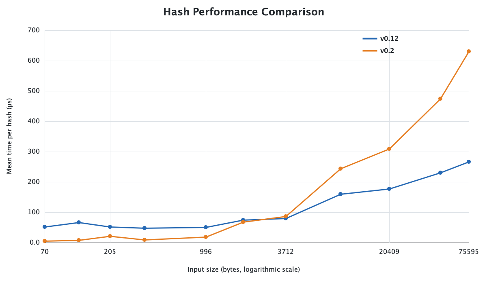
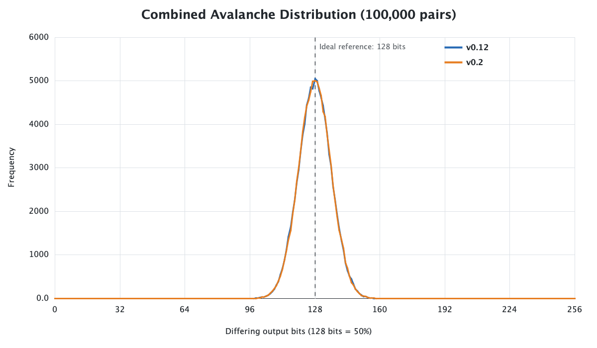

# Blokų grandinių technologijų 1 užduotis 

## Apie projektą

Tai mokomasis 256 bitų maišos funkcijos projektas, įgyvendintas su Java 21. Funkcija priima baitų seką ir grąžina 64 mažųjų raidžių hex simbolių rezultatą. Tekstas koduojamas UTF-8, o failo režimu skaičiuojama tikslių failo baitų maiša, įskaitant tarpus ir eilučių pabaigas.

## v0.12 algoritmo pseudokodas

`v0.12` naudoja aštuonis 32 bitų būsenos elementus, todėl galutinis rezultatas turi 256 bitus.

```text
state = 8 pradinės 32 bitų reikšmės

kiekvienam įvesties baitui pozicijoje i:
    unsignedByte = baito reikšmė nuo 0 iki 255
    current = i mod 8
    next = (current + 1) mod 8

    state[current] XOR= unsignedByte + i
    pasukti state[current] bitus į kairę
    prie state[current] pridėti state[next]

įmaišyti įvesties ilgį į pirmą ir paskutinį state elementus

5 kartus pereiti per visus state elementus:
    dabartinį elementą sujungti su kitu per XOR
    pasukti jo bitus į kairę per 7 pozicijas
    rezultatą pridėti prie kito elemento

paversti 8 state elementus į 64 hex simbolius
```

Naudojamos trys algoritmo versijos:

- **v0.1** – pradinė realizacija;
- **v0.12** – pridėtas galutinis maišymas, gerokai pagerinęs lavinos efektą;
- **v0.2** – DI (GPT 6 Astra) padedant išplėsta `v0.12` versija. Pridėti papildomi bitų poslinkiai, daugyba iš konstantų ir maišymas su tolimesniais būsenos elementais.

## Kompiliavimas ir paleidimas

Projektui reikia Java 21 ir Maven.

```bash
mvn compile
mvn test
```

Teksto maiša:

```bash
java -cp target/classes hashing.Main text "hello world"
```

Failo maiša:

```bash
java -cp target/classes hashing.Main file data/inputs/konstitucija.txt
```

Kabutės reikalingos, kai tekste yra tarpų. Komandinės eilutės tekstui naujos eilutės simbolis automatiškai nepridedamas.

Norimą maišos funkcijos versiją galima pasirinkti pakeičiant naudojamą `HashFunction` realizaciją. Visus eksperimentus paleidžia:

```bash
java -cp target/classes hashing.experiment.ExperimentRunner
```

## Eksperimentų rezultatai

### 1. Įvestys

[`data/inputs/`](data/inputs/) kataloge yra tuščias failas, vieno baito įvestys, ilgesni atsitiktiniai failai, vieno baito pakeitimai skirtingose vietose, struktūruotos įvestys ir UTF-8 tekstas su lietuviškais simboliais.

### 2–3. Formatas ir determinizmas

Paleisti JUnit testai patvirtino, kad funkcija priima tuščią įvestį, visada grąžina 64 mažųjų raidžių hex simbolius ir tiems patiems baitams pateikia tą patį rezultatą. Taip pat patikrintos pakartotinių kvietimų, `A, B, A`, UTF-8 bei vienodų teksto ir failo baitų situacijos.

### 4. Sparta

| Įvestis (baitais) | v0.12 vidurkis (µs) | v0.2 vidurkis (µs) |
|---:|---:|---:|
| 70 | 52.49 | 5.58 |
| 123 | 66.47 | 7.66 |
| 205 | 51.95 | 21.33 |
| 362 | 47.90 | 8.87 |
| 996 | 50.93 | 18.55 |
| 1 841 | 75.21 | 67.38 |
| 3 712 | 79.85 | 87.13 |
| 9 155 | 159.59 | 244.17 |
| 20 409 | 176.90 | 308.67 |
| 47 434 | 231.02 | 475.21 |
| 75 595 | 266.39 | 631.10 |



Didėjant įvesčiai, ilgėja abiejų versijų vykdymo laikas. Visam failui `v0.2` buvo apie 2,37 karto lėtesnė, nes atlieka daugiau maišymo operacijų.

### 5. Kolizijos

| Duomenys | Ilgis | Porų skaičius | v0.12 poros / grupės | v0.2 poros / grupės |
|---|---:|---:|---:|---:|
| Atsitiktinis ASCII | 10 | 100 000 | 0 / 0 | 0 / 0 |
| Atsitiktinis ASCII | 100 | 100 000 | 0 / 0 | 0 / 0 |
| Atsitiktinis ASCII | 500 | 100 000 | 0 / 0 | 0 / 0 |
| Atsitiktinis ASCII | 1 000 | 100 000 | 0 / 0 | 0 / 0 |
| Struktūruotos įvestys | 12 | 2 | 0 / 0 | 0 / 0 |

Kolizijų nerasta nei tikrinant poras, nei visą sugeneruotų įvesčių rinkinį. Tai parodo tik šio riboto eksperimento rezultatą ir neįrodo kriptografinio atsparumo kolizijoms.

### 6. Lavinos efektas

Bitų skirtumas:

| Ilgis | v0.12 min. / maks. / vid. (%) | v0.2 min. / maks. / vid. (%) |
|---:|---:|---:|
| 10 | 37.8906 / 62.8906 / 49.9900 | 37.8906 / 62.1094 / 50.0001 |
| 100 | 37.5000 / 61.7188 / 50.0049 | 36.3281 / 62.1094 / 49.9652 |
| 500 | 38.6719 / 63.2813 / 49.9794 | 36.7188 / 62.8906 / 50.0373 |
| 1 000 | 33.9844 / 62.5000 / 49.9859 | 37.8906 / 61.3281 / 49.9770 |
| **Visi** | **33.9844 / 63.2813 / 49.9901** | **36.3281 / 62.8906 / 49.9949** |

Hex simbolių skirtumas:

| Ilgis | v0.12 min. / maks. / vid. (%) | v0.2 min. / maks. / vid. (%) |
|---:|---:|---:|
| 10 | 79.6875 / 100.0000 / 93.7350 | 79.6875 / 100.0000 / 93.7639 |
| 100 | 78.1250 / 100.0000 / 93.7679 | 79.6875 / 100.0000 / 93.7343 |
| 500 | 78.1250 / 100.0000 / 93.7504 | 79.6875 / 100.0000 / 93.7718 |
| 1 000 | 76.5625 / 100.0000 / 93.7407 | 79.6875 / 100.0000 / 93.7267 |
| **Visi** | **76.5625 / 100.0000 / 93.7485** | **79.6875 / 100.0000 / 93.7492** |



Abiejų versijų vidurkis beveik sutampa su idealia 50 % bitų skirtumo reikšme. `v0.2` šiek tiek pagerino blogiausią bendrą rezultatą, tačiau vidutinis pokytis labai mažas.

### 7. Spėjimas ir druska

Tikslinė įvestis buvo `0427`, o kandidatų rinkinį sudarė visos reikšmės nuo `0000` iki `9999`.

| Versija | Režimas | Kandidatai | Bandymai | Atitikmenys | Laikas (ms) |
|---|---|---:|---:|---:|---:|
| v0.12 | Be druskos | 10 000 | 10 000 | 1 | 27.69 |
| v0.12 | Vieša druska | 10 000 | 10 000 | 1 | 21.85 |
| v0.2 | Be druskos | 10 000 | 10 000 | 1 | 3.96 |
| v0.2 | Vieša druska | 10 000 | 10 000 | 1 | 4.99 |

Mažą kandidatų rinkinį galima pilnai perrinkti. Vieša druska neapsunkina vieno taikinio paieškos, bet trukdo tuos pačius iš anksto apskaičiuotus rezultatus naudoti skirtingiems taikiniams. Slaptas atsitiktinis `r` padidintų nežinomą paieškos erdvę. 

### 8. Išvados

Didžiausias pagerėjimas pasiektas `v0.12` versijoje: galutinis maišymas pakėlė vidutinį bitų skirtumą nuo 35.3246 % iki 49.9901 %. `v0.2` vidurkį pakeitė nedaug, tačiau pagerino blogiausią bendrą lavinos rezultatą. Abiejose versijose kolizijų nerasta.

Papildomas `v0.2` maišymas padidino skaičiavimo laiką, todėl ši versija nėra vienareikšmiškai geresnė. Ji iškeitė dalį spartos į šiek tiek stipresnę sklaidą.

## DI naudojimas

Padėjo:
- kurti ir tvarkyti eksperimentų kodą;
- patobulinti algoritmą `v0.2` versijai;
- parengti README;
- sugeneruoti rezultatų grafikus.

## Duomenys ir atkūrimas

Pradiniai CSV rezultatai saugomi kataloguose:

- [`data/results/v0.1/`](data/results/v0.1/)
- [`data/results/v0.12/`](data/results/v0.12/)
- [`data/results/v0.2/`](data/results/v0.2/)

Eksperimentų kodas yra [`src/main/java/hashing/experiment`](src/main/java/hashing/experiment/), o įvestys – [`data/inputs`](data/inputs/). Rezultatus galima atkurti paleidus unit testus ir `ExperimentRunner`.
